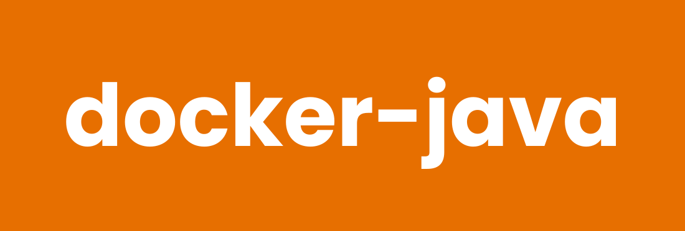

# docker-java



[](https://github.com/ragedunicorn/docker-java/actions/workflows/docker_release.yml)
[](https://github.com/ragedunicorn/docker-java/actions/workflows/test.yml)


> Docker Alpine image with Eclipse Temurin 21 — JDK (with Apache Maven) and JRE variants.


## Overview

This Docker image provides a minimal Java installation built on Alpine Linux. It ships [Eclipse Temurin](https://adoptium.net/) 21 (LTS) installed from the official Adoptium apk repository rather than Alpine's `openjdk` packages, so the Java distribution and version are fixed independently of the Alpine release.

Two variants are published from this repository:

- **jdk** (`latest`) — full JDK with `javac`, `jar`, `jshell`, and Apache Maven (`mvn`); use it to compile and build
- **jre** (`latest-jre`) — runtime only; use it to run precompiled applications

## Features

- **Small footprint**: compact runtime image using Alpine Linux
- **Eclipse Temurin 21 LTS**: pinned Adoptium build, updated independently of Alpine
- **Apache Maven**: pinned official binary in the JDK variant, updated independently of Alpine
- **Two variants**: full JDK for building, minimal JRE for running
- **Non-root user**: Enhanced security with dedicated java user
- **Volume mounting**: Easy code and data access through `/app`

## Quick Start

```bash
# Pull the JDK image
docker pull ragedunicorn/java:latest

# Pull the JRE image
docker pull ragedunicorn/java:latest-jre

# Print the Java version (default command)
docker run --rm ragedunicorn/java:latest
```

For development and building from source, see [DEVELOPMENT.md](DEVELOPMENT.md).

## Usage

The container uses `java` as the entrypoint, so any Java parameters can be passed directly to the `docker run` command.

### Basic Usage

```bash
# Using the JDK image
docker run -v $(pwd):/app ragedunicorn/java:latest [java-options]

# Using the JRE image
docker run -v $(pwd):/app ragedunicorn/java:latest-jre [java-options]

# Using an exact version combination
docker run -v $(pwd):/app ragedunicorn/java:<java-version>-jdk-alpine<alpine-version>-<build> [java-options]
```

Available tags are listed on [Docker Hub](https://hub.docker.com/r/ragedunicorn/java/tags) and in the
[GitHub releases](https://github.com/RagedUnicorn/docker-java/releases).

### Examples

#### Run a Java Source File (single-file source launch, JDK only)
```bash
docker run -v $(pwd):/app ragedunicorn/java:latest Hello.java
```

#### Run a Jar
```bash
docker run -v $(pwd):/app ragedunicorn/java:latest-jre -jar app.jar
```

#### Interactive Java Shell (JDK only)
```bash
docker run -it --rm --entrypoint jshell ragedunicorn/java:latest
```

#### Compile a Source File (JDK only)
```bash
docker run -v $(pwd):/app --entrypoint javac ragedunicorn/java:latest Hello.java
```

#### Build with Maven (JDK only)
```bash
# The named volume keeps the local repository (~/.m2) between runs,
# so dependencies are not re-downloaded on every build. A fresh volume is
# initialized owned by the java user (the image pre-creates ~/.m2).
docker run -v $(pwd):/app -v m2cache:/home/java/.m2 --entrypoint mvn ragedunicorn/java:latest package
```

> **Note (Docker Desktop for Windows):** overwriting existing files on a
> Windows bind mount can fail with `Operation not permitted` for the non-root
> `java` user. If your Maven build writes into the mounted workspace (e.g.
> copies generated resources over existing files), run as root and move the
> cache volume to root's home:
>
> ```bash
> docker run -u root -v ${PWD}:/app -v m2cache-root:/root/.m2 --entrypoint mvn ragedunicorn/java:latest package
> ```

#### Check Java Version
```bash
docker run --rm ragedunicorn/java:latest -version
```

## Docker Compose Usage

This repository includes Docker Compose configurations for easier usage and common Java workflows.

### Basic Setup

1. Create an `app` directory:
```bash
mkdir -p app
```

2. Place your Java files in `app/`

3. Run Java using docker compose:
```bash
docker compose run --rm jdk Hello.java
docker compose run --rm jre -jar app.jar
```

### Example Configuration

The `examples/` directory contains a hello-world example:

#### Hello World Example (`examples/docker-compose.yml`)
```bash
# Run the hello world example
cd examples && docker compose run --rm hello-world
```

### Environment Variables

The compose configuration supports:

- `JAVA_JDK_VERSION`: JDK image version (default: latest)
- `JAVA_JRE_VERSION`: JRE image version (default: latest-jre)
- `TERM`: Terminal type for colored output

### Tips

1. **Custom Commands**: Override the default command:
   ```bash
   docker compose run --rm jdk -XshowSettings:properties -version
   ```

2. **Development Mode**: Use the development compose file for building locally:
   ```bash
   docker compose -f docker-compose.dev.yml build
   docker compose -f docker-compose.dev.yml run --rm java-dev
   ```

3. **Persistent Settings**: The repository includes a `.env` file with default settings:
   ```env
   JAVA_JDK_VERSION=latest
   JAVA_JRE_VERSION=latest-jre
   ```

## Building Custom Images

The JRE variant is the natural base for shipping an application:

```dockerfile
FROM ragedunicorn/java:latest-jre

COPY app.jar /app/app.jar

CMD ["-jar", "/app/app.jar"]
```

The JDK variant is the natural base for build stages or images that need the compiler. To install additional Alpine packages, switch users temporarily:

```dockerfile
FROM ragedunicorn/java:latest

USER root
RUN apk add --no-cache git
USER java
```

## Versioning

This project uses semantic versioning that matches the Docker image contents:

**Format:** `{java_version}-{jdk|jre}-alpine{alpine_version}-{build_number}`

Examples (`X.Y.Z` is the Temurin version, `A.B.C` the Alpine version):
- `X.Y.Z-jdk-alpineA.B.C-1` - Temurin X.Y.Z JDK on Alpine A.B.C, build 1
- `X.Y.Z-jre-alpineA.B.C-1` - Temurin X.Y.Z JRE on Alpine A.B.C, build 1
- `latest` - Most recent stable JDK release
- `latest-jre` - Most recent stable JRE release

The current tags are listed on [Docker Hub](https://hub.docker.com/r/ragedunicorn/java/tags).

A single git tag (`v{java_version}-alpine{alpine_version}-{build_number}`) produces both variant images. For the detailed release process and versioning guidelines, see [RELEASE.md](RELEASE.md).

## Automated Dependency Updates

This project uses [Renovate](https://docs.renovatebot.com/) to automatically check for updates to:
- Alpine Linux base image version (all major, minor, and patch updates)
- The pinned Eclipse Temurin version, discovered from the Adoptium apk repository listing
- The pinned Apache Maven version (minor and patch updates within Maven 3), discovered from Maven Central

Renovate runs weekly (every Monday) and creates pull requests when updates are available. Every Alpine reference is kept in sync from a single update: the `FROM` line, the `org.opencontainers.image.base.name` OCI labels, and the Alpine version asserted in `test/jdk_metadata_test.yml` and `test/jre_metadata_test.yml` are grouped into one pull request. The Temurin pin covers both variants — jdk and jre releases are in lockstep — and is grouped separately.

## Documentation

- [Development Guide](DEVELOPMENT.md) - Building, debugging, and contributing
- [Testing Guide](TEST.md) - Running and writing tests
- [Release Process](RELEASE.md) - Creating releases and versioning

## Links

- [Eclipse Temurin / Adoptium](https://adoptium.net/)
- [Adoptium Alpine Installation](https://adoptium.net/installation/linux/)
- [Alpine Linux](https://www.alpinelinux.org/)

# License

MIT License

Copyright (c) 2026 Michael Wiesendanger

Permission is hereby granted, free of charge, to any person obtaining a copy
of this software and associated documentation files (the "Software"), to deal
in the Software without restriction, including without limitation the rights
to use, copy, modify, merge, publish, distribute, sublicense, and/or sell
copies of the Software, and to permit persons to whom the Software is
furnished to do so, subject to the following conditions:

The above copyright notice and this permission notice shall be included in all
copies or substantial portions of the Software.

THE SOFTWARE IS PROVIDED "AS IS", WITHOUT WARRANTY OF ANY KIND, EXPRESS OR
IMPLIED, INCLUDING BUT NOT LIMITED TO THE WARRANTIES OF MERCHANTABILITY,
FITNESS FOR A PARTICULAR PURPOSE AND NONINFRINGEMENT. IN NO EVENT SHALL THE
AUTHORS OR COPYRIGHT HOLDERS BE LIABLE FOR ANY CLAIM, DAMAGES OR OTHER
LIABILITY, WHETHER IN AN ACTION OF CONTRACT, TORT OR OTHERWISE, ARISING FROM,
OUT OF OR IN CONNECTION WITH THE SOFTWARE OR THE USE OR OTHER DEALINGS IN THE
SOFTWARE.
